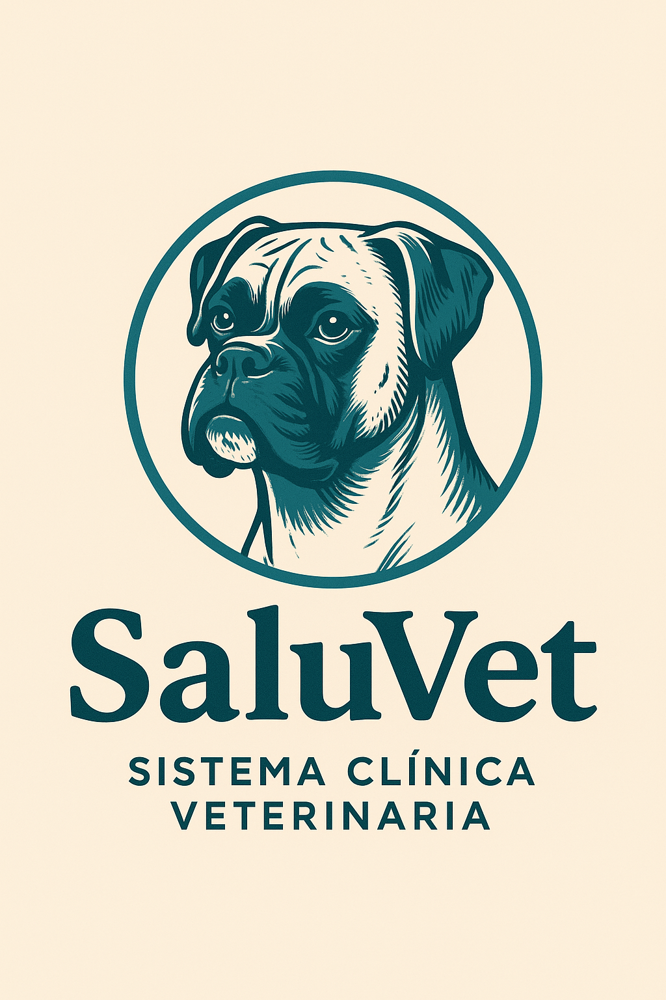

# 🐾 SaluVet MVP

#### Versión: 1.0

### [Bitácora](/docs/bitacora.md)
### [Historias de Usuario](/docs/user-stories.md)

---

SaluVet es un sistema de gestión diseñado para clínicas veterinarias, con el objetivo de organizar eficientemente la atención de pacientes (mascotas), el historial médico, la vacunación y los turnos. El sistema contempla múltiples roles con permisos diferenciados para reflejar el flujo de trabajo real de una clínica veterinaria.

---

## 🎯 Problema que resuelve.
Actualmente, muchas veterinarias gestionan sus operaciones de forma manual o con herramientas genéricas como planillas, agendas en papel o software sin adaptación al rubro. Esto genera:

* Pérdida o duplicación de información médica.

* Turnos superpuestos o mal asignados.

* Dificultad para hacer seguimiento de vacunaciones.

* Acceso desorganizado a la información de mascotas y dueños.

SaluVet busca resolver estos problemas con una API centralizada, accesible por múltiples roles, permitiendo registrar, visualizar y gestionar la información clave de manera ordenada y segura.

---

## 👥 Roles del sistema
* ***Superadmin***: Responsable de configurar la clínica. Puede crear usuarios (recepcionistas y veterinarios), ver reportes generales y administrar la base completa.

* ***Recepcionista***: Administra los turnos, registra nuevos dueños y mascotas, y gestiona la atención inicial.

* ***Veterinario***: Registra consultas médicas, aplica vacunas y accede al historial clínico de sus pacientes.

* ***Dueño de mascota (futuro módulo)***: Podrá visualizar turnos, historial y vacunas de su mascota.

---

## 🖥️ Tecnologías

NestJS - TypeScript - MySQL - Prisma - Swagger - JWT

---

## Variables de entorno

En un archivo llamado ``.env`` copiar y pegar las siguientes variables de entorno.
```.env
NODE_ENV=development
PORT=7500
VERSION=v1

#Database
DATABASE_TYPE=mysql
DATABASE_HOST=localhost
DATABASE_PORT=3306
DATABASE_NAME=saluvet_db
DATABASE_USERNAME=TuUsuario
DATABASE_PASSWORD=TuPassword
DATABASE_URL=${DATABASE_TYPE}://${DATABASE_USERNAME}:${DATABASE_PASSWORD}@${DATABASE_HOST}:${DATABASE_PORT}/${DATABASE_NAME}

#JWT
JWT_SECRET=supersecreto
JWT_EXPIRES_IN=24h

#Superadmin Credentials
SUPERADMIN_EMAIL=superadmin@saluvet.com
SUPERADMIN_PASSWORD=password123
SUPERADMIN_NAME=superadmin

#ResetPassword
RESET_PASSWORD_DEFAULT=saluvet123

#ScheduleConfigDayVariables
DEFAULT_STARTIME=8
DEFAULT_ENDTIME=16

```

---

## 💻 Instalación paso a paso

### 1. Clonar el proyecto e instalar dependencias.
```bash
git clone https://github.com/RafaToresani/SaluVet-backend.git
cd saluvet
npm install
```
### 2. Crear base de datos mysql vacía.
(usar el nombre que hayas definido en .env)
```sql
CREATE DATABASE saluvet_db;
```
### 3. Aplicar migraciones con Prisma.
```bash
npx prisma migrate dev
```
### 4. Compilar y correr el proyecto

```bash
# development
 npm run start

# watch mode
 npm run start:dev

# production mode
 npm run start:prod
```
### 5. Ingresar a swagger
```bash
http://localhost:7500/docs

```

### 6. Ingresar con el superadmin creado automáticamente (según tu .env) y empezar a probar el sistema.
```json
{
  "email": "superadmin@saluvet.com",
  "password": "password123"
}
```
